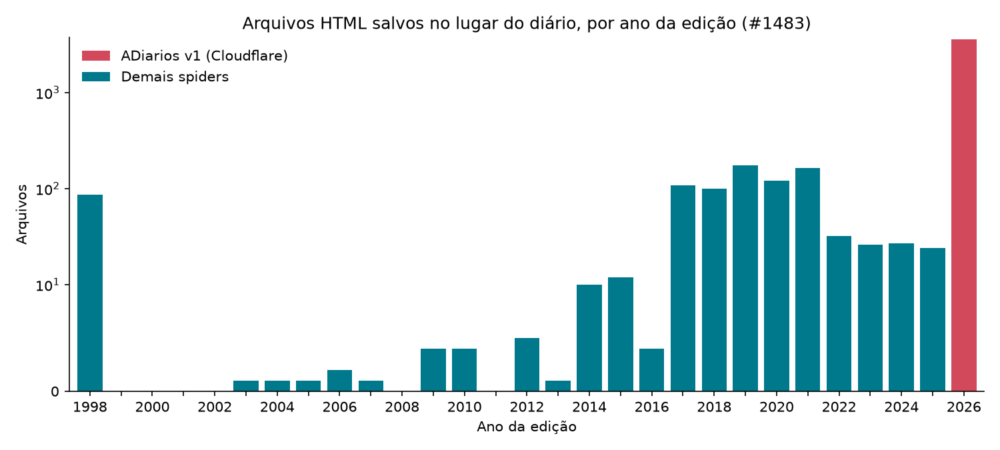

# Arquivos HTML salvos no lugar do diário oficial — análise do inventário da #1483

Análise exploratória dos **4.491 arquivos** que o `data-processing` não conseguiu
extrair (inventário anexado à issue
[#1483](https://github.com/okfn-brasil/querido-diario/issues/1483), gerado em
2026-09-19). O objetivo é responder **onde** o problema está concentrado, **se
ele ainda acontece** e **qual o tipo de correção** cada grupo pede.



## Resumo

1. **80% do problema é um único padrão, e é o único ainda ativo.** Os 3.577
   arquivos do `BaseAdiariosV1Spider` (31 municípios, jan–set/2026) são a página
   de desafio do Cloudflare Turnstile, confirmado em 31 de 31 amostras. Nos
   três meses anteriores ao inventário, fora do ADiarios só aparecem **2
   arquivos** (Itápolis e Campos dos Goytacazes).
2. **O restante (914 arquivos) é passivo histórico**, concentrado em 4 spiders
   individuais que somam 87% dele: Jaboatão dos Guararapes (463), Barra Mansa
   (180), Campo Grande (90) e Santana (59).
3. **A extensão do arquivo não serve para detectar o problema.** 129 arquivos
   HTML foram salvos com extensão `.pdf`, e em Valinhos o próprio servidor da
   prefeitura responde `Content-Type: application/pdf` para um HTML. Só a
   checagem do **conteúdo** identifica esses casos.
4. **O detector proposto em `feat/monitor-tipo-de-arquivo` classificou 99 de
   99 arquivos reais da amostra como HTML** usando apenas o conteúdo. Na
   primeira versão foram 98 de 99, e o caso perdido (Catanduva) virou um ajuste
   no detector.

## O que foi salvo no lugar do diário

Classificação feita a partir de uma amostra estratificada de 99 arquivos (até 3
por spider: o mais antigo, o do meio e o mais recente; 1 por município no
ADiarios), extrapolada para todos os arquivos do mesmo spider.

| Conteúdo salvo | Arquivos | Municípios | % |
|:--|--:|--:|--:|
| Desafio Cloudflare Turnstile | 3.577 | 31 | 79,6 |
| Edição do diário publicada em HTML (Jaboatão dos Guararapes) | 463 | 1 | 10,3 |
| Aviso "outra transferência em andamento a partir do seu IP" (Barra Mansa) | 180 | 1 | 4,0 |
| Página não encontrada, servida com HTTP 200 (Campo Grande) | 90 | 1 | 2,0 |
| Página do portal da prefeitura | 69 | 15 | 1,5 |
| Visualizador do Google Drive (Santana) | 59 | 1 | 1,3 |
| Página de listagem do Diário Oficial (portais Instar) | 32 | 7 | 0,7 |
| Não amostrado: o spider de São Paulo não existe mais no repositório | 13 | 1 | 0,3 |
| Página do sistema Siganet | 3 | 3 | 0,1 |
| Painel do Power BI (Porto Alegre) | 3 | 1 | 0,1 |
| Erro 502 do proxy (Manaus) | 1 | 1 | 0,0 |
| Fragmento HTML com script de analytics (Catanduva) | 1 | 1 | 0,0 |

A tabela descreve **o que o arquivo contém**, não a causa. As causas abaixo
foram verificadas rodando o raspador contra o site real em 2026-10-29.

## Diagnósticos verificados

### Valinhos/SP ([#1544](https://github.com/okfn-brasil/querido-diario/issues/1544)): o dado está corrompido na origem

- Rodando `sp_valinhos` nas 4 datas do inventário, o link de download de cada
  edição faz um redirecionamento `<meta http-equiv="refresh">` para
  `/uploads/<hash>.pdf`. Esse arquivo, no servidor da prefeitura, é uma cópia
  HTML da página inicial do portal antigo (~51 KB), servida com
  `Content-Type: application/pdf`.
- O arquivo baixado pelo raspador é idêntico, byte a byte, ao do servidor. As
  outras edições dos mesmos dias baixam PDFs válidos.
- **Conclusão:** não há correção possível no raspador, porque o diário não
  existe na origem. Os 4 arquivos podem ser marcados como irrecuperáveis e
  retirados da fila do `data-processing`.

### Barra Mansa/RJ ([#1529](https://github.com/okfn-brasil/querido-diario/issues/1529)): causa no raspador, e o spider está quebrado hoje

- Os 180 arquivos (2017–2025) são o aviso do WordPress Download Manager
  "Outra transferência está em andamento a partir do seu IP", servido com
  HTTP 200. O servidor limita **um download simultâneo por IP**, e o Scrapy
  baixa até 8 arquivos em paralelo por domínio. Uma correção seria
  `CONCURRENT_REQUESTS_PER_DOMAIN = 1`, como em outros spiders do projeto.
- **Situação atual:** o spider extrai 0 itens. A listagem passou a ser
  carregada por AJAX (`admin-ajax.php`, ação `wpdm_all_packages_data`), e esse
  endpoint responde com o desafio do Cloudflare Turnstile. Recuperar o spider
  depende da mesma decisão pendente para o ADiarios (item (b) da #1483).

### Itápolis/SP: falha transitória

- Ao recoletar a data do inventário (2026-06-29), o site entregou o PDF
  correto. Uma nova coleta da data resolve.

## Recomendações

| Grupo | Arquivos | Tipo de ação |
|:--|--:|:--|
| ADiarios v1 (Cloudflare) | 3.577 | O #1551 já impede novos arquivos. A recuperação depende da decisão do item (b) da #1483 |
| Jaboatão dos Guararapes | 463 | O conteúdo **é** o diário, em HTML. Vale avaliar a extração de HTML no `data-processing` em vez de mudar o raspador |
| Barra Mansa | 180 | Limitar a concorrência. O spider também precisa voltar a funcionar (bloqueado por Cloudflare) |
| Valinhos | 4 | Marcar como irrecuperável (corrompido na origem) |
| Casos isolados (até 5 arquivos por município, exceto Valinhos) | 45 | Coletar as datas de novo antes de investigar o spider (Itápolis já voltou a funcionar) |
| Prevenção para todos os casos | — | Monitor de tipo de arquivo (`feat/monitor-tipo-de-arquivo`): alerta no Discord já na execução que salvar HTML |

## Como reproduzir

Requer o ambiente do projeto (`uv sync --all-groups` em `querido_diario_raspadores/`)
e a branch `feat/monitor-tipo-de-arquivo` (para `gazette.utils.files`).

```console
cd querido_diario_raspadores
# 1. inventário da #1483
curl -sSL -o /tmp/inventario.csv https://github.com/user-attachments/files/32418517/data-processing-extraction-problems-2026-09-19.csv
# 2. mapa território -> spider -> spider base, a partir do código
uv run python ../analises/arquivos-html-1483/scripts/mapear_spiders.py > /tmp/spiders.csv
# 3. cruzamento, totais por spider base, ano e recorrência
uv run --with pandas python ../analises/arquivos-html-1483/scripts/analisar.py /tmp/inventario.csv /tmp/spiders.csv /tmp/enriquecido.csv
# 4. amostra estratificada, download e classificação pelo conteúdo
uv run --with pandas python ../analises/arquivos-html-1483/scripts/amostrar.py /tmp/enriquecido.csv /tmp/amostra.csv
../analises/arquivos-html-1483/scripts/baixar_amostra.sh /tmp/amostra.csv /tmp/amostras
uv run python ../analises/arquivos-html-1483/scripts/classificar.py /tmp/amostra.csv /tmp/amostras /tmp/amostra_classificada.csv
# 5. resumo por conteúdo salvo e gráfico
uv run --with pandas --with matplotlib --with tabulate python ../analises/arquivos-html-1483/scripts/resumir.py /tmp/enriquecido.csv ../analises/arquivos-html-1483/dados/conteudo_por_spider.csv /tmp/grafico.png
```

Arquivos em `dados/`:

- `spiders.csv`: os 449 spiders do repositório, com território, spider base e
  `start_date`.
- `inventario_enriquecido.csv`: o inventário da #1483 com o spider vigente na
  data de cada arquivo (`merge_asof` por `start_date`), a spider base e o ano.
- `amostra_classificada.csv`: os 99 arquivos amostrados, com o tipo detectado,
  a detecção do Cloudflare, o tamanho e o `<title>`.
- `conteudo_por_spider.csv`: classificação manual do conteúdo salvo, feita a
  partir da amostra.

## Limitações

- A classificação por conteúdo usa uma amostra (até 3 arquivos por spider) e
  supõe que os arquivos de um mesmo spider têm a mesma causa. Spiders com
  muitos arquivos podem misturar causas.
- O spider vigente é inferido pelo código atual. Arquivos coletados por
  spiders que já foram alterados ou removidos (como o de São Paulo) podem ter
  outra origem.
- "Recorrência" usa a data da **edição**, não a data da coleta, que não está no
  inventário.
